<div align="center">

# TriageFlow

**A customer-support desk run by four Claude agents, with a live console that shows every step they take.**

[](https://github.com/divyanshgarg3011/TriageFlow/actions/workflows/ci.yml)


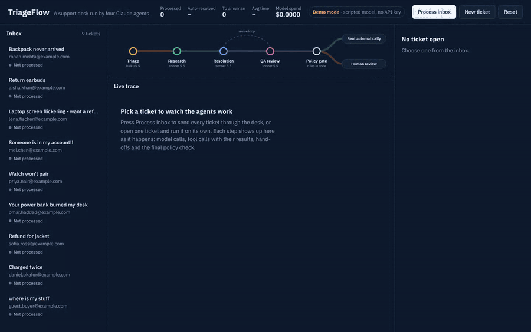

</div>

---

## Contents

- [What it does](#what-it-does)
- [Quick start](#quick-start)
- [How it works](#how-it-works)
  - [The pipeline](#the-pipeline)
  - [The four agents](#the-four-agents)
  - [Inside one agent: the tool-use loop](#inside-one-agent-the-tool-use-loop)
  - [One ticket, end to end](#one-ticket-end-to-end)
  - [The policy gate](#the-policy-gate)
  - [System architecture](#system-architecture)
- [The live console](#the-live-console)
- [Design decisions](#design-decisions)
- [Evaluation](#evaluation)
- [Tests and CI](#tests-and-ci)
- [Configuration](#configuration)
- [Project structure](#project-structure)
- [Roadmap](#roadmap)

---

## What it does

A support ticket arrives, for example *"My backpack never arrived, tracking hasn't moved in 12 days."* TriageFlow:

1. **Triages** it: category, priority, sentiment, order number, and whether a human must see it.
2. **Researches** it with real tools: looks up the customer and the order in a database and searches the company's policy documents.
3. **Resolves** it: asks a policy engine what the customer is entitled to, proposes actions (refund, reship, store credit, account lock) and drafts a reply.
4. **Reviews** it: a QA agent checks the draft for made-up facts, policy breaks and tone, and can send it back for a rewrite.
5. **Gates** it: plain Python rules decide whether the reply and actions go out automatically or wait for a human to approve, edit or reject them.

Everything happens live in the browser: each model call, each tool call with its arguments and result, each hand-off between agents, and the gate's final decision.

The store is a fictional shop, **Nimbus Gear** (outdoor gear and electronics), with customers, orders and refunds in SQLite and a policy knowledge base in Markdown. Agents look facts up instead of inventing them.

### Highlights

| | |
|---|---|
| **Multi-agent workflow** | 4 specialised agents with their own prompts, tools, models and structured outputs |
| **Real tool use** | 6 tools over a SQLite store, a TF-IDF policy search and a deterministic refund policy engine |
| **Self-correction** | A QA agent can return a draft with specific feedback (bounded revise loop) |
| **Safety by design** | Agents only *propose* actions; code verifies and executes them; risky cases fail closed to a human |
| **Human in the loop** | Review, edit, approve or reject escalated tickets from the console |
| **Observability** | Every step streamed over Server-Sent Events with tokens, latency and cost per call |
| **Evaluated** | 20 labelled tickets scored on routing, escalation recall/precision and action accuracy |
| **Runs anywhere** | Demo mode uses a scripted offline model, so it works with no API key |

---

## Quick start

```bash
git clone https://github.com/divyanshgarg3011/TriageFlow.git
cd TriageFlow
python -m venv .venv && source .venv/bin/activate      # Windows: .venv\Scripts\activate
pip install -r requirements.txt
cp .env.example .env                                     # then add your ANTHROPIC_API_KEY
uvicorn app.server:app --reload
```

Open **http://localhost:8000** and press **Process inbox**.

| Mode | When | What runs |
|---|---|---|
| **Live** | `ANTHROPIC_API_KEY` is set | Claude Haiku 5.5 for triage, Claude Sonnet 5.5 for research, resolution and QA |
| **Demo** | No key, or `DEMO_MODE=1` | A scripted offline model that returns the same response format, for demos with no cost or network |

The header of the console always shows which mode is active.

**Docker**

```bash
docker build -t triageflow .
docker run -p 8000:8000 -e ANTHROPIC_API_KEY=sk-ant-... triageflow
```

---

## How it works

### The pipeline

```mermaid
flowchart LR
    IN([Ticket]) --> T

    subgraph AGENTS [LLM agents]
        direction LR
        T["Triage<br/><sub>Haiku 5.5</sub>"] --> R["Research<br/><sub>Sonnet 5.5</sub>"]
        R --> S["Resolution<br/><sub>Sonnet 5.5</sub>"]
        S --> Q["QA review<br/><sub>Sonnet 5.5</sub>"]
        Q -. "revise<br/>(max 2)" .-> S
    end

    Q --> G{"Policy gate<br/><sub>plain Python</sub>"}
    G -- "all checks pass" --> AUTO(["Execute actions<br/>+ send reply"])
    G -- "any check fails" --> HUM(["Human review<br/>approve · edit · reject"])
    HUM -- approve --> AUTO

    classDef triage fill:#F2B233,stroke:#F2B233,color:#0E1B2C
    classDef research fill:#35B8A6,stroke:#35B8A6,color:#0E1B2C
    classDef resolution fill:#6B9BF2,stroke:#6B9BF2,color:#0E1B2C
    classDef qa fill:#D46A9F,stroke:#D46A9F,color:#0E1B2C
    classDef gate fill:#C9D3DE,stroke:#C9D3DE,color:#0E1B2C
    classDef auto fill:#5CC48A,stroke:#5CC48A,color:#0E1B2C
    classDef human fill:#F07A4A,stroke:#F07A4A,color:#0E1B2C
    class T triage
    class R research
    class S resolution
    class Q qa
    class G gate
    class AUTO auto
    class HUM human
```

The order of the steps is fixed code. Inside each step, the agent decides for itself which tools to call and when it has enough information. This keeps the system predictable and testable while still letting the model do the judgement work.

### The four agents

| Agent | Model | Job | Tools | Output (structured) |
|---|---|---|---|---|
| **Triage** | Haiku 5.5 | Classify the ticket and flag anything a human must see (legal threats, safety incidents, account takeover) | none | `category`, `priority`, `sentiment`, `order_id`, `needs_human_now`, `confidence` |
| **Research** | Sonnet 5.5 | Gather verified facts and the policies that apply | `get_customer`, `get_order`, `list_customer_orders`, `search_knowledge_base` | `key_facts`, `policies`, `open_questions` |
| **Resolution** | Sonnet 5.5 | Decide the fix, propose actions, write the reply | `check_refund_eligibility`, `search_knowledge_base`, `propose_action` | `reply`, `rationale`, `confidence` + proposed actions |
| **QA review** | Sonnet 5.5 | Check grounding, policy, safety and tone | `search_knowledge_base` | `verdict` (approve / revise / escalate), `risk_score`, `issues`, `feedback` |

Triage uses the cheapest, fastest model because it is pure classification. The steps that need reasoning use Sonnet. Each agent's model can be changed in `.env`.

### Inside one agent: the tool-use loop

Every agent runs the same small loop ([`app/agent_loop.py`](app/agent_loop.py)). An agent finishes by calling its own `submit_*` tool, whose JSON schema is the agent's output contract. That gives the next agent clean, validated data instead of free text to parse.

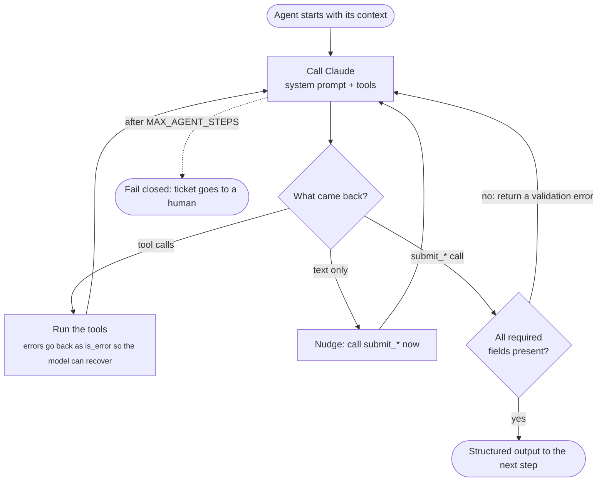

Every box in this diagram emits an event, which is what the console animates.

### One ticket, end to end

Ticket **T-1001**, a backpack that never arrived. QA catches a missing delivery timeline in the first draft and sends it back once.

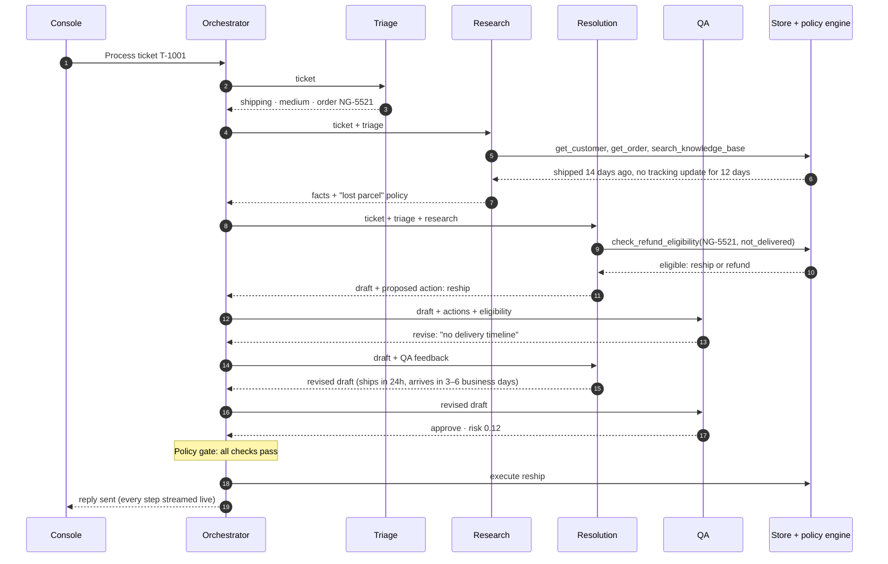

### The policy gate

The gate is plain Python ([`policy_gate()` in `app/orchestrator.py`](app/orchestrator.py)). The model cannot talk its way past it. A ticket goes to a human if **any** of these is true:

| Check | Why |
|---|---|
| Triage flagged it (legal threat, safety incident, account takeover) | These always need a person |
| Category is `safety` | Never auto-handle safety incidents |
| Triage or resolution confidence below 0.6 | The model is unsure, so don't guess |
| QA verdict is not `approve`, or QA risk score above 0.6 | The reviewer has concerns |
| Total refund or credit above $500 | Matches the shop's manager-approval policy |
| A refund, reship or replacement **was not confirmed eligible** by the policy engine | The agent can't grant what policy doesn't allow |
| A refund **exceeds the policy maximum**, even if QA approved it | Defence in depth against a wrong amount |
| An account lock is proposed | Requires the security team |

Ticket lifecycle:

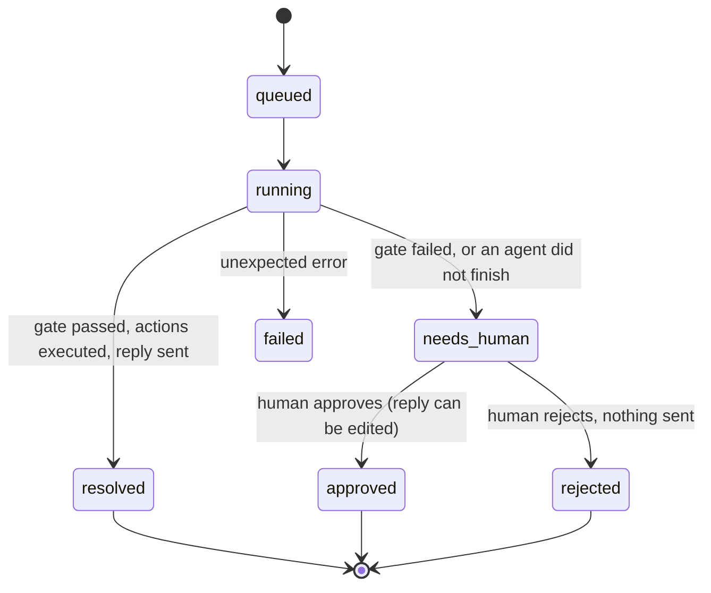

### System architecture

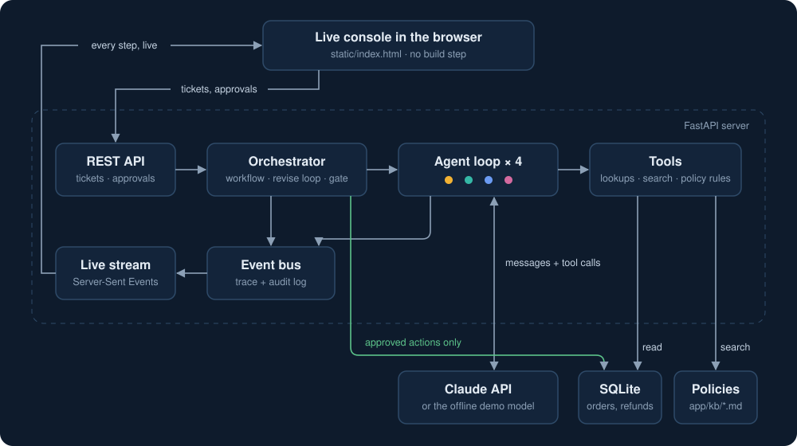

Runs are async with a concurrency limit (`MAX_PARALLEL_RUNS`), so several tickets are worked on at the same time.

---

## The live console

The console is a single HTML file with no build step. The pipeline at the top is drawn like a transit map: each agent is a station with its own line colour, and the ticket travels the line as the agents work.

**Escalated to a human.** A $1,299 refund is above the auto-approval limit, so the gate stops it. Nothing has been refunded or sent; the reviewer can edit the draft and approve or reject it.

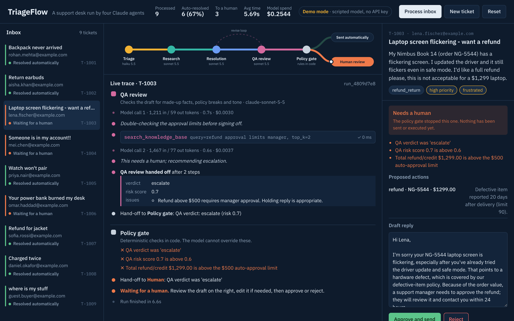

**A safety incident with a legal threat.** Triage flags it straight away; the other agents still gather context and draft a holding reply, so the human starts with everything they need.

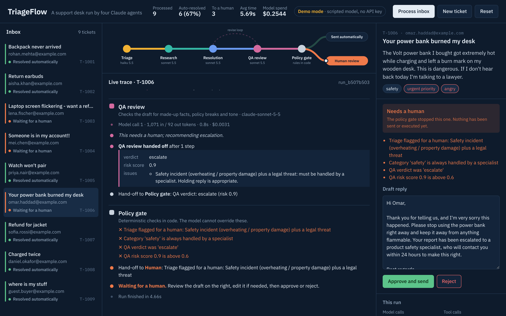

<table>
<tr>
<td width="62%" valign="top">

**Every tool call is inspectable.** Expand any call to see the exact arguments the agent sent and the result it got back.

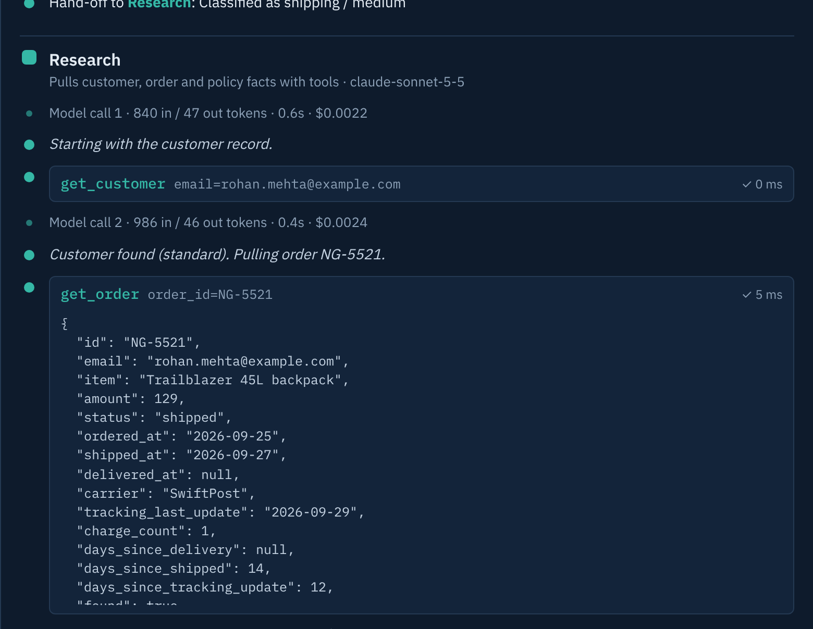

</td>
<td width="38%" valign="top">

**Works on a phone.** The layout stacks into one column.

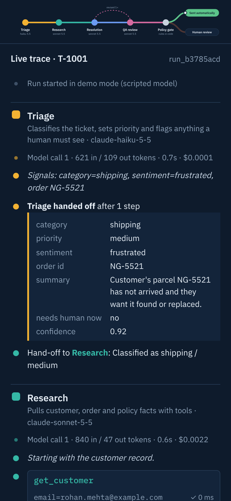

</td>
</tr>
</table>

**Write your own ticket** and watch the agents handle it.

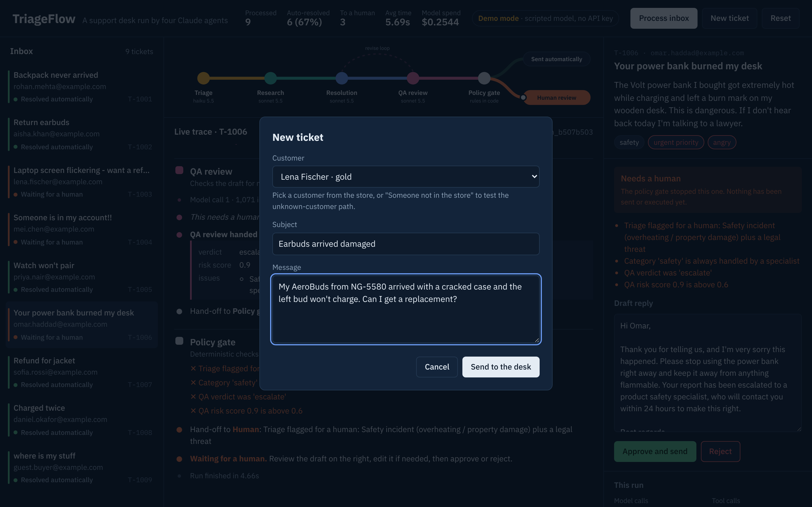

**Resolved automatically.** The full run for T-1001, including the revision QA asked for.

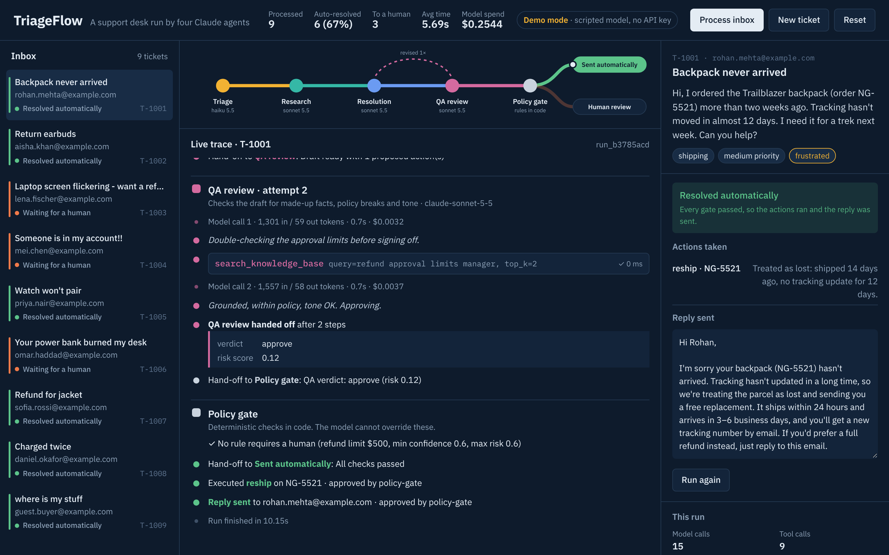

---

## Design decisions

<details open>
<summary><b>1. A fixed workflow on the outside, agents on the inside</b></summary>

The order of steps is ordinary Python; each step is an LLM agent free to choose its own tool calls. A fully autonomous "the agent decides what to do next" design is harder to test, debug and reason about, and customer support has a known shape. This gets the flexibility of agents where it helps and predictability everywhere else.
</details>

<details open>
<summary><b>2. Agents propose, code executes</b></summary>

`propose_action` only records an intent. Refunds, reships and account locks happen only after QA and the policy gate pass, or a human approves. `db.record_action()` is the single place where state changes, which makes the system easy to audit.
</details>

<details>
<summary><b>3. Rules that must never be wrong are not left to the model</b></summary>

Refund eligibility is a deterministic policy engine (`check_refund_eligibility`): return windows, defect windows, lost-parcel rules, duplicate charges, membership tiers. The model asks it rather than reasoning about policy itself, and the gate re-checks every proposed money action against its answers.
</details>

<details>
<summary><b>4. Fail closed</b></summary>

Low confidence, high QA risk, an agent that doesn't finish, or anything flagged as legal, safety or account takeover goes to a human. A wrong escalation costs a few minutes of someone's time; a wrong automatic refund costs money and trust. The evaluation reflects this: escalation recall is the metric that must never drop.
</details>

<details>
<summary><b>5. Structured outputs through tools</b></summary>

Each agent ends by calling a `submit_*` tool with a JSON schema. Hand-offs are validated data, not prose to parse, and a missing field is sent back to the model as an error to fix.
</details>

<details>
<summary><b>6. The right model for each job</b></summary>

Classification runs on Haiku; reasoning, writing and critique run on Sonnet. Each run reports tokens and cost per call, so the trade-off is visible.
</details>

<details>
<summary><b>7. Bounded self-correction</b></summary>

QA can return a draft with specific feedback at most `MAX_REVISIONS` times (default 2). Past that, the ticket goes to a human instead of looping.
</details>

<details>
<summary><b>8. A demo model behind the same interface</b></summary>

`MockClient` returns Anthropic-shaped responses (text and `tool_use` blocks), so the real and offline paths share every line of the loop, tools, gate and UI. Tests and CI run without a key. The demo model is a stand-in for showing the system, not a measure of its quality; the evaluation section explains how to get real numbers.
</details>

---

## Evaluation

[`evals/dataset.jsonl`](evals/dataset.jsonl) holds 20 labelled tickets: the 9 inbox samples and 11 harder variants (different phrasing, edge cases, policy boundaries). The runner sends each one through the full pipeline on a fresh database and scores the structured outputs directly, with no LLM-as-judge.

```bash
python -m evals.run_evals            # runs on Claude when ANTHROPIC_API_KEY is set
python -m evals.run_evals --demo     # offline keyword baseline
python -m evals.run_evals --only T-1003 E-07
```

| Metric | What it measures |
|---|---|
| **Escalation recall** | Of the tickets that *must* reach a human, how many did. The safety metric. |
| **Escalation precision** | Of the tickets sent to a human, how many needed it. The cost metric. |
| Routing accuracy | Auto-resolved vs sent to a human, as expected |
| Category accuracy | Triage label matches the expected category |
| Action match | Proposed action types match the expected ones exactly |
| Cost, latency, model calls, revisions | What handling a ticket costs |

**Baseline: keyword rules instead of an LLM** (demo mode)

| Category | Routing | Escalation recall | Escalation precision | Action match | Fully correct |
|:---:|:---:|:---:|:---:|:---:|:---:|
| 80% | 80% | **100%** | 56% | 85% | 75% |

The baseline breaks on tickets that don't contain its keywords, such as a VAT invoice request, a snapped watch strap or a shipping question about Canada, and it over-escalates a plain password reset. Escalation recall still stays at 100%: when the baseline is unsure, the gate sends the ticket to a human rather than guessing. That is the fail-closed design working.

Run the same set on Claude to compare. Each run writes a JSON file and a Markdown report to `evals/results/`.

---

## Tests and CI

```bash
pytest -q
```

26 tests cover:

- the policy engine: return windows, Gold-member store credit, the $500 manager-approval rule, lost parcels, duplicate charges
- the knowledge-base search returning the right policy section
- the routing of all 9 sample tickets
- the revise loop running and being traced
- escalated tickets changing nothing until a human approves
- the gate catching a refund that QA approved but the policy engine never confirmed, or that exceeds the allowed maximum
- the HTTP API, including the approval flow

GitHub Actions runs the tests and the baseline evaluation on every push ([`.github/workflows/ci.yml`](.github/workflows/ci.yml)).

---

## Configuration

All settings live in `.env` (see [`.env.example`](.env.example)).

| Variable | Default | What it does |
|---|---|---|
| `ANTHROPIC_API_KEY` | none | Runs on Claude when set; demo mode otherwise |
| `DEMO_MODE` | `0` | `1` forces the offline model |
| `TRIAGE_MODEL` | `claude-haiku-5-5` | Model for triage |
| `RESEARCH_MODEL`, `RESOLUTION_MODEL`, `QA_MODEL` | `claude-sonnet-5-5` | Models for the other agents |
| `REFUND_AUTO_LIMIT` | `500` | Refunds above this always go to a human |
| `MIN_CONFIDENCE` | `0.6` | Below this, the ticket goes to a human |
| `MAX_RISK` | `0.6` | QA risk above this goes to a human |
| `MAX_REVISIONS` | `2` | Maximum QA revise loops |
| `MAX_PARALLEL_RUNS` | `3` | Tickets processed at the same time |
| `DEMO_STEP_DELAY` | `0.6` | Seconds per step in demo mode, so you can watch it |

Model prices used for the cost figures are in `app/config.py`; check them against [Anthropic's pricing page](https://platform.claude.com/docs/en/about-claude/pricing).

---

## Project structure

```
triageflow/
├── app/
│   ├── agents.py          # prompts, tools and output schemas for the four agents
│   ├── agent_loop.py      # the shared tool-use loop, validation and metrics
│   ├── orchestrator.py    # workflow, revise loop, policy gate, human decisions
│   ├── tools.py           # tool functions, policy search, refund policy engine
│   ├── llm.py             # Claude client
│   ├── mock_llm.py        # offline demo model with the same response format
│   ├── db.py              # SQLite store, seeded relative to today's date
│   ├── events.py          # event bus behind the live stream and audit trail
│   ├── server.py          # FastAPI: REST endpoints + Server-Sent Events
│   ├── config.py          # settings, model choice, prices, thresholds
│   ├── kb/                # policy documents the agents search
│   └── static/index.html  # the live console
├── data/sample_tickets.json
├── evals/                 # labelled dataset + scorer
├── tests/                 # pytest suite
├── docs/media/            # screenshots and demo GIF
├── Dockerfile
└── requirements.txt
```

### API

| Method | Path | Purpose |
|---|---|---|
| `GET` | `/api/tickets` | Inbox with each ticket's latest status |
| `POST` | `/api/tickets` | Create a ticket and start processing it |
| `POST` | `/api/tickets/{id}/run` | Process (or re-process) one ticket |
| `POST` | `/api/run-all` | Process every unprocessed ticket |
| `GET` | `/api/runs/{run_id}` | Run summary plus its full event trace |
| `POST` | `/api/runs/{run_id}/decision` | Human approve or reject, optionally with an edited reply |
| `GET` | `/api/stream` | Live event stream (Server-Sent Events) |
| `GET` | `/api/stats` | Totals: processed, auto-resolved, escalated, cost |
| `POST` | `/api/reset` | Restore sample tickets and data |

---

## Roadmap

- [ ] Expose the tools as an **MCP server** so any MCP client can use the same store
- [ ] **Prompt caching** for the long system prompts, with a before/after cost comparison
- [ ] An **LLM-as-judge** score for reply quality, calibrated on human-graded examples
- [ ] Learn from reviewers: store the diff between each draft and what the human sent, and reuse it as few-shot examples
- [ ] Postgres and a job queue for runs and events, plus a "replay this run" view

---

<div align="center">

Built by **[Divyansh Garg](https://github.com/divyanshgarg3011)** · MIT licensed

</div>
